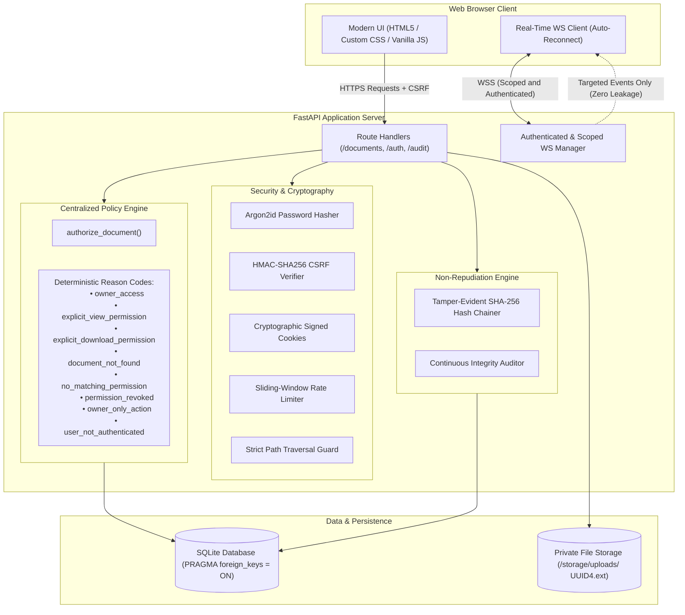
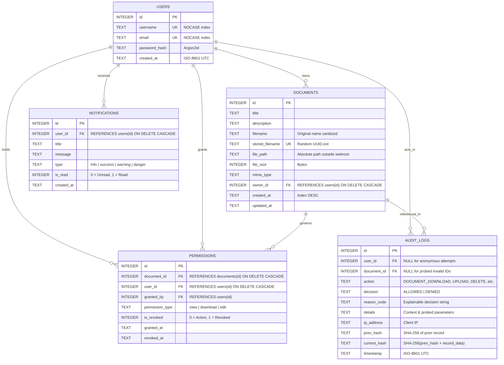

# 🛡️ DocShield — Zero-Trust Explainable Document Vault

> **Hiring Assessment Submission**  
> *"Not the number of screens. A system where the wrong person genuinely cannot reach a document, where you can prove who did, and where you can explain every authorisation decision in your code."*

DocShield is a production-grade, zero-trust document management system built with **FastAPI**, **SQLite**, **Jinja2**, and **WebSockets**. It is engineered from first principles to guarantee that authorization is never delegated to frontend presentation layers, every access attempt produces an explainable decision trace, and all interactions are cryptographically sealed in a tamper-evident audit log.

---

## 🏛️ System Architecture




---

## 📊 Database Entity-Relationship (ER) Diagram



### Schema & Index Design
1. **Foreign Key Integrity**: Enforced globally on every connection via `PRAGMA foreign_keys = ON;`.
2. **Compound Indexes**:
   - `idx_permissions_lookup`: On `(document_id, user_id, permission_type, is_revoked)` for sub-millisecond authorization evaluation.
   - `idx_audit_timestamp`: Indexed chronologically for rapid audit filtering and hash chain verification.
   - `idx_documents_owner`: Indexed to isolate multi-tenant user documents immediately.
3. **Storage Isolation**: Raw file payloads are stripped of user filenames, stored under randomized UUIDs inside `storage/uploads/`, and strictly segregated from the web root.

---

## 🧠 Centralized Explainable Authorization Engine

The core policy engine resides in `app/authorization.py` under the function:
```python
authorize_document(conn: sqlite3.Connection, user_id: Optional[int], document_id: Optional[int], action: str) -> AuthorizationDecision
```

Every document access route (`download`, `view`, `share`, `revoke`, `delete`) invokes this function before querying storage.

### Decision Pipeline:
1. **Identity Verification**: Verifies the actor has a valid session. Rejects unauthenticated attempts with code `user_not_authenticated`.
2. **Existence & Enumeration Protection**: Confirms document existence. Prevents direct object enumeration with code `document_not_found`.
3. **Ownership Evaluation**: If `user_id == owner_id`, returns `allowed=True` with reason `owner_access`.
4. **Owner-Only Guard**: Actions that modify the document lifecycle (`delete`, `share`, `revoke`) are restricted exclusively to owners. Non-owners receive `allowed=False` with code `owner_only_action`.
5. **Explicit Granular Permissions**: Scans `permissions` table for active records matching the requested action (`view` or `download`).
6. **Revocation Check**: If a matching permission was revoked (`is_revoked = 1`), explicitly denies with code `permission_revoked`.
7. **Default Deny**: If no explicit permission exists, access is denied with code `no_matching_permission`.

---

## 🔗 Cryptographic Non-Repudiation (Tamper-Evident Audit Trail)

## Tamper-Evident Audit Logging

To cryptographically verify audit log integrity and improve accountability, DocShield implements a **SHA-256 hash chain** that links each audit record to the previous record.

The hash for each audit record is calculated as follows:

$$
\text{current\_hash} = \text{SHA-256}(\text{prev\_hash} \parallel \text{canonical\_record})
$$

The `canonical_record` contains a deterministic serialization of these fields:

- `user_id`
- `doc_id`
- `action`
- `decision`
- `reason_code`
- `details`
- `timestamp`

### Security Guarantees

- **Genesis Hash:** The first audit record references a predefined 64-character zero hash.
- **Tamper Detection:** Modifying an audit record causes hash verification to fail for the affected record and potentially subsequent linked records.
- **Integrity Verification:** The `/api/audit/verify` endpoint and the UI's **Verify Hash Chain** button verify the chain and identify the first detected integrity mismatch.
- **User Accountability:** Each audit record associates an action with the authenticated user's identifier.
- **Chain Integrity:** Each record incorporates the previous record's hash, linking the audit history cryptographically.
- **Additional Protection:** Periodically store the latest chain hash in a separately protected location to help detect attempts to rewrite the entire audit history.

**Security Note:** A SHA-256 hash chain provides tamper evidence, not absolute tamper prevention. Protection against an attacker who can modify the entire database requires independently protected checkpoints and appropriate access controls. User attribution also depends on secure authentication and session management.

---

## ⚡ Scoped Real-Time WebSockets (Zero-Leakage Architecture)

DocShield delivers instant updates without page reloads using FastAPI WebSockets (`/ws`):

* **Handshake Authentication**: The WebSocket connection checks the cryptographically signed `docshield_session` cookie during connection initialization. Unauthenticated requests are rejected immediately with WebSocket code `4401`.
* **Zero Broadcast Leakage**: The `ScopedConnectionManager` maintains private connection maps keyed strictly by `user_id`.
  - When Alice uploads a document, only Alice's dashboard receives the event.
  - When Alice shares a document with Bob, only Bob receives the invitation toast and new document record.
  - When an unauthorized user attempts to download Alice's document, an instant **Security Alert** is dispatched to Alice's active browser session containing the actor's username and the denial reason.
  - Confidential metadata is never broadcast to connected peers.

---

## 🚀 Quick Start Guide (Run Locally)

### Prerequisites
* Python 3.10+ (Tested up to Python 3.14)
* Virtual environment (optional but recommended)

### 1. Installation
Clone the repository and install dependencies:
```bash
git clone <your-repo-url>
cd docshield
pip install -r requirements.txt
```

### 2. Environment Configuration
Copy `.env.example` to `.env`:
```bash
cp .env.example .env
```

### 3. Run Application
On Windows:
```cmd
run.bat
```
Or on Linux/macOS:
```bash
chmod +x run.sh
./run.sh
```
Or directly via Uvicorn:
```bash
python -m uvicorn main:app --host 127.0.0.1 --port 8000 --reload
```

Open your browser to: **[http://127.0.0.1:8000](http://127.0.0.1:8000)**

### 4. Pre-Seeded Demonstration Accounts
The database automatically seeds 3 demo users on first startup:
* `alice` / `Password123!`
* `bob` / `Password123!`
* `charlie` / `Password123!`

---

## 🧪 Automated Test Suite (28 Tests Passed)

DocShield includes a comprehensive, isolated Pytest test suite validating all 13 assessment requirements:

```bash
python -m pytest -v
```

### Test Coverage Summary:
| # | Test Category | Pytest Function | Outcome |
| :---: | :--- | :--- | :---: |
| 1 | **Registration & Login** | `test_user_registration_success`, `test_user_login_success` | ✅ PASS |
| 2 | **Argon2 Password Hashing** | `test_argon2_password_hashing`, `test_user_login_invalid_password` | ✅ PASS |
| 3 | **Owner Document Access** | `test_auth_engine_owner_access`, `test_owner_download_own_document` | ✅ PASS |
| 4 | **Unauthorized Access Denial** | `test_unauthorized_user_cannot_reach_document` | ✅ PASS |
| 5 | **Access After Sharing** | `test_sharing_grants_access_and_revocation_denies_it` | ✅ PASS |
| 6 | **Access After Revocation** | `test_auth_engine_explicit_permissions_and_revocation` | ✅ PASS |
| 7 | **IDOR / ID Tampering Attacks** | `test_idor_document_id_tampering` | ✅ PASS |
| 8 | **File Type & Size Validation** | `test_invalid_file_extension_rejected`, `test_oversized_upload_rejected` | ✅ PASS |
| 9 | **CSRF Protection** | `test_csrf_protection_enforcement` | ✅ PASS |
| 10 | **Unauthorized Sharing & Deletion**| `test_unauthorized_sharing_and_deletion_blocked` | ✅ PASS |
| 11 | **Explainable Audit Trail** | `test_audit_logging_and_explainable_reasons`, `test_audit_tamper_detection` | ✅ PASS |
| 12 | **WebSocket Authentication** | `test_websocket_unauthenticated_connection_rejected` | ✅ PASS |
| 13 | **Prevention of Event Leakage** | `test_websocket_event_isolation_and_no_leakage` | ✅ PASS |

---

## 🛡️ Security Assessment & Production Readiness Gap Analysis

> *Never claim an application is completely secure. Here is an honest appraisal of DocShield's threat model and the additional protections required for high-risk enterprise production deployments:*

### Defenses Implemented in DocShield:
1. **Argon2id Hashing**: Memory-hard hashing immune to GPU/ASIC rainbow attacks.
2. **Cryptographic Cookie Signatures**: HMAC-SHA256 authenticated cookies prevent session forging.
3. **Double-Submit / Secret-Bound CSRF**: State-changing operations require constant-time verified tokens.
4. **Brute-Force Rate Limiting**: Sliding-window rate limiter locks down accounts under credential-stuffing attacks.
5. **Path Traversal Shield**: Canonical resolution checks ensure requests cannot navigate above the private upload root.
6. **Zero-Trust Server Policy**: No file I/O occurs without explicit evaluation by `authorize_document()`.
7. **Tamper-Evident Merkle Logs**: Hash chaining ensures audit entries cannot be modified undetected.

### Gaps & Upgrades Required Before Production:
1. **Envelope Encryption at Rest (KMS)**: Currently, files are stored on disk with UUID filenames. For banking/HIPAA compliance, each document should be encrypted with a unique AES-256-GCM data key wrapped by an external Key Management Service (AWS KMS or HashiCorp Vault).
2. **Distributed Rate Limiting (Redis)**: The current in-memory rate limiter protects single-node deployments. In a multi-replica Kubernetes cluster, rate limiting must be shared via a centralized Redis cluster.
3. **Malware / Virus Scanning**: Uploaded files should pass through an asynchronous ClamAV or sandbox scanner before being released for download.
4. **Content Security Policy (CSP)**: In production HTTPS, strict CSP headers (`script-src 'self'`, `frame-ancestors 'none'`, `object-src 'none'`) should be enforced at the reverse proxy (Nginx / Cloudflare) to eliminate XSS vectors.
5. **SIEM Audit Forwarding**: Audit log records should be streamed in real-time to an immutable external SIEM (Splunk, Datadog, or AWS CloudWatch Logs with Write-Once-Read-Many policies).
